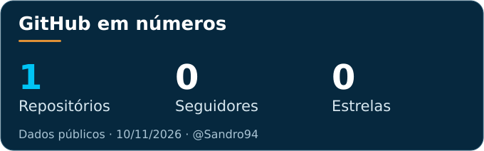

  
    
  
  
  

# Olá, eu sou o Sandro 👋

Empreendedor à frente da **Milagres Transparente**, conectando turismo, tecnologia e experiências digitais em Alagoas.

Transformo necessidades da operação turística em soluções digitais: da apresentação dos passeios à organização do atendimento e à automação de rotinas. Meu foco é construir uma jornada clara, rápida e acolhedora para quem viaja e para quem atende.

- **Empreendedorismo e turismo:** experiências pela Rota Ecológica dos Milagres, Maragogi e Maceió.
- **Tecnologia aplicada:** plataformas web, integrações e automação de processos.
- **Experiência digital:** mobile, acessibilidade, performance e privacidade.

## Tecnologias e ferramentas

Stack verificada na plataforma Milagres Transparente: frontend estático em HTML, CSS e JavaScript, build em módulos ESM com Node.js, integrações pontuais em PHP e testes com Playwright.

**Web e integrações**

  
  
  
  
  

**Qualidade, versionamento e publicação**

  
  
  
  

## Projeto em destaque · Milagres Transparente

**Uma plataforma digital para descobrir Alagoas e planejar experiências com atendimento humano.**

- Passeios e destinos em São Miguel dos Milagres, Maragogi, Praia do Patacho e Maceió.
- Experiência mobile com seleção de múltiplos passeios e solicitação guiada em três etapas.
- Integração com WhatsApp para encaminhar as preferências e conversar com a equipe.
- Vídeos locais Full HD, SEO técnico e controles de privacidade integrados à navegação.

**[Conheça a plataforma →](https://www.milagrestransparente.com/)**

## Atividade no GitHub

  

Atualização diária pelo GitHub Actions. O cálculo de linguagens considera repositórios públicos, sem forks e sem incluir este perfil. Projetos privados não entram nesse ranking; a stack verificada está apresentada acima.

---

  <strong>Da experiência no destino à experiência digital.</strong> 
  Milagres Transparente · Alagoas, Brasil

